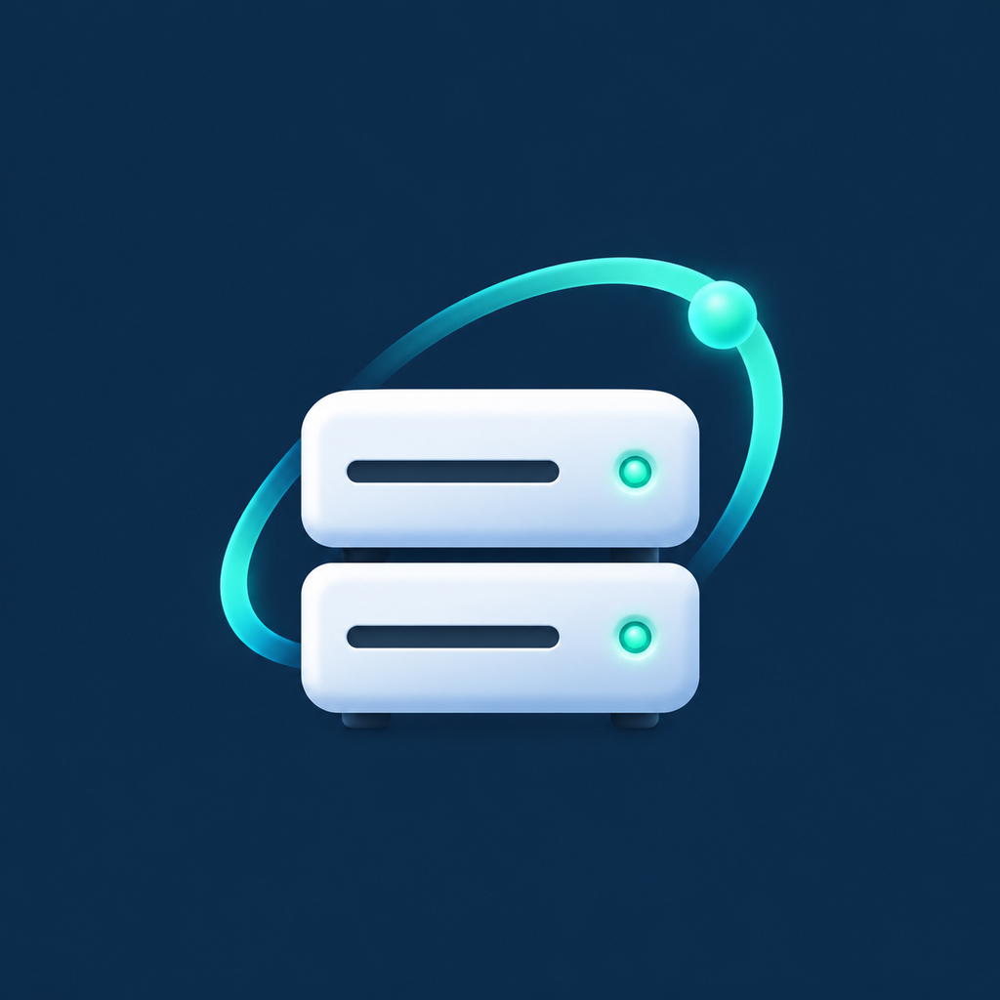

# DsmClient



DsmClient 是面向群晖 Synology DSM 的 Flutter 移动客户端，计划基于现有代码重新开发，逐步梳理功能、更新界面并改善维护体验。

本项目以 [群晖助手 DSM helper](https://gitee.com/apaipai/dsm_helper) 为起点，保留原作者版权及开源许可。当前处于重新开发的初始阶段，现有实现及兼容性需要逐项验证。

## 项目状态

- 应用名称：`DsmClient`；Dart 包名：`dsm_client`。
- 已导入原项目代码，保留现有功能作为后续开发基础。
- 当前适配目标为 DSM 7.4.1；基础协议与套件发现已进行 NAS 只读验证，移动端完整功能仍需逐项验证。
- 已移除广告 SDK、广告展示、免广告付费及兑换入口，启动不再检查广告权益。
- Android 开发测试版通过 [GitHub Releases](https://github.com/318182456/DsmClient/releases) 分发。原项目渠道不作为本项目的发布渠道。

## 现有功能基础

以下是现有代码涵盖的模块，不代表已在 DsmClient 中验证通过。

| 模块 | 范围 |
| --- | --- |
| 登录与连接 | NAS 连接、账号管理与认证 |
| 控制台 | 系统状态、存储、资源监控、通知及快捷入口 |
| 文件管理 | File Station 浏览、上传下载、搜索、分享及文件操作 |
| 系统管理 | 控制面板、用户、共享文件夹、任务计划、日志及套件管理 |
| 套件 | Docker、Virtual Machine Manager、Download Station 等 |
| 媒体 | 照片浏览、音视频播放及本地播放器插件 |
| 工具与设置 | SSH 终端、主题设置及相册备份相关代码 |

## DSM 7 与 NAS 应用

- 登录前查询 `SYNO.API.Info`，使用 NAS 返回的认证路径及兼容版本；支持 OTP 和 CSRF 会话令牌。
- 请求按连接地址和会话 ID 隔离令牌，切换账号时恢复相应会话，上传与组合请求使用已发现的版本范围。
- 识别 `DSM 7.4.1-90080 Update 1` 等版本格式，DSM 7 小版本沿用对应界面资源。
- 主菜单显示可用的原生工作区与 NAS 桌面应用，支持搜索和刷新。Node.js、Python、Perl、Git、编解码器等纯依赖不显示，仍可在套件中心管理。没有专用工作区的桌面套件标注为“套件管理”，提供运行状态刷新和服务启停，不显示“未接入”占位页。
- File Station、Photos、Container Manager、存储、控制面板、日志等继续使用现有原生模块。

| 程序 | 当前原生功能 |
| --- | --- |
| Synology Drive | 文件与控制台两个独立入口；我的文件、团队文件夹、分页浏览、上传下载、新建目录、重命名、移动、回收站删除、创建分享链接；连接设备、同步日志、服务信息 |
| Audio Station | 歌曲、专辑、歌手、播放列表、文件夹、曲库搜索、分页加载、音频播放 |
| Hyper Backup | 任务、存储库、备份日志、实时任务状态；立即备份、取消任务（操作前确认） |
| Cloud Sync | 云端连接、同步任务、日志、连接设置、同步中文件、最近同步；暂停与恢复（操作前确认） |
| Snapshot Replication | 共享文件夹快照列表、说明及锁定状态、创建普通快照、复制任务查看 |
| qBittorrent / Transmission | 原生任务与速率总览、搜索筛选排序、多选批量操作、文件优先级、Tracker/连接详情、任务限速、磁力/链接与本地 .torrent 添加、开始/暂停/强制开始/校验/更新 Tracker；移除可保留或确认删除文件。登录信息可选择加密保存。兼容 qBittorrent 空响应 204，按 Transdroid 的功能组织方式设计，未复制其代码 |
| SAN Manager | LUN 与 Target 列表及详情 |
| WebDAV Server | HTTP/HTTPS 开关状态、端口与连接参数查看 |
| Hybrid Share | 共享信息查看 |
| 容器 | 可按 NAS 选择群晖 Container Manager 或 Dockhand；Dockhand 支持独立账号/MFA/API Token、环境选择、容器/镜像/Compose 项目/网络/卷、日志/配置/资源/进程及启停重启。菜单仅展示 Dockhand、qBittorrent、Transmission 等已支持独立页面的容器；全部容器可在管理器查看 |
| RR Manager 4.x | 概览、引导配置编辑、Addons/Modules 选择、在线/本地 RR 与 RR Manager 更新、日志；修改操作须在应用内确认，本客户端不发送重启请求 |
| 其他桌面套件 | 保留 NAS 原生图标和套件运行管理；纯运行库仅在套件中心显示 |

以上为当前实现范围，尚未覆盖每个程序的完整功能。Drive 历史版本/回收站浏览、备份任务创建与恢复、云盘授权与任务创建、Office 在线编辑等仍待开发。新增读取接口已在 DSM 7.4.1 上进行只读验证；写操作按接口实现，未在用户 NAS 上执行破坏性或状态变更测试。音频流端点也已验证；移动端交互与音频解码仍需 Android 实机验证。qBittorrent 4/5 命令切换及 Transmission CSRF 协商已通过本地 HTTP 服务集成测试，尚未使用用户程序账号做真实任务变更。快照恢复/删除、第三方媒体库原生业务与 Tailscale 管理也尚未实现。套件运行管理不代表已实现对应程序全部业务功能。RR 只读日志已在 NAS 验证，未对用户引导执行写配置、升级或重启测试。Dockhand 使用独立认证；可选择记住账号密码或 API Token，使用 Android Keystore / iOS Keychain 加密保存，按 NAS 和服务地址隔离，验证码不保存，可随时清除。

认证流程参考 [Synology DSM Login Web API Guide](https://global.download.synology.com/download/Document/Software/DeveloperGuide/Os/DSM/All/enu/DSM_Login_Web_API_Guide_enu.pdf)。

## 图标

程序菜单读取 NAS 自己的套件图标配置及图片资源，区分 Drive 文件和控制台；内置 DSM 模块保留原生图标缓存，不生成替代的套件图标。DsmClient 启动图标主图为 `assets/logo.png`。Android 提供各密度图标、自适应图标及 Android 13 单色主题图标；iOS 提供完整 AppIcon 尺寸及启动图资源。

更新下载默认使用用户指定的 `https://edgeone.gh-proxy.org/` 前缀，可切换 GitHub 直连或自定义 HTTPS 代理。应用内下载、浏览器下载、复制链接使用同一选择；应用内下载保留大小与 SHA-256 校验。代理只用于本项目公开发布附件，不附带 NAS 会话。

## 重新开发方向

以下为初步规划，均为待开展事项，可随开发调整。

- [ ] 复现开发环境，跑通 Android / iOS 基础构建。
- [ ] 梳理 NAS 登录、会话管理、网络请求和错误处理。
- [ ] 建立 DSM 6 / DSM 7 功能与接口兼容性清单。
- [ ] 优先验证登录、控制台、文件管理及下载等核心流程。
- [ ] 重新设计界面、导航和主题，统一交互风格。
- [ ] 评估 Flutter、Dart 和第三方依赖升级，分阶段迁移。
- [x] 移除穿山甲广告 SDK、开屏/激励视频、免广告付费及兑换服务。
- [x] 将更新源切换到本仓库 GitHub Releases，并接入应用内更新。
- [x] 移除加群、频道、公众号、打赏、旧微信小程序反馈及原项目推广服务。
- [ ] 补充核心测试、持续集成及发布流程。


界面使用统一的浅色与深色主题、平面分区卡片和清晰的状态标签；Audio Station、Dockhand、控制面板及独立程序页面已重新排版。自动测试覆盖文字对比度、320px 窄屏与 160% 字体、程序菜单过滤，以及 Dockhand 登录信息隔离、恢复和清除。

## 开发环境

当前源码沿用的环境基线：

| 项目 | 配置 |
| --- | --- |
| Flutter | `3.7.12`，见 `.fvmrc` |
| Dart | 根目录 SDK 约束为 `>=2.10.0 <3.0.0` |
| JDK | 11（原项目要求） |
| Android | compileSdk / targetSdk 33，minSdk 21 |
| iOS | Podfile 最低版本 12.0；需 macOS、Xcode 和 CocoaPods |

当前包含旧版本插件、Git 依赖及本地 `fplayer` 插件，升级 SDK 前需评估依赖兼容性。

## 获取源码

仓库使用 Git LFS 管理 iOS 播放器框架二进制文件，需先安装 Git LFS。

```sh
git lfs install
git clone https://github.com/318182456/DsmClient.git
cd DsmClient
git lfs pull
flutter pub get
```

使用 Flutter 3.7.12。部分依赖从 GitHub 和 Gitee 拉取，开发环境需能够访问对应仓库。如使用 FVM，可通过 `fvm flutter` 执行 Flutter 命令。

## 运行与构建

### Android

安装 Android SDK，并配置本地 Flutter / Android SDK 路径。当前 `android/app/build.gradle` 会读取 `android/key.properties`，debug 与 release 均使用 release 签名；运行前需自行准备签名配置及密钥。

`android/key.properties` 示例，替换为自己的配置：

```properties
storePassword=YOUR_STORE_PASSWORD
keyPassword=YOUR_KEY_PASSWORD
keyAlias=YOUR_KEY_ALIAS
storeFile=YOUR_KEYSTORE_PATH
```

`storeFile` 可使用绝对路径或相对于 `android/app` 的路径。签名配置和密钥文件不纳入版本控制。

```sh
flutter devices
flutter run
flutter build apk --release
```

### iOS

在 macOS 上准备 Xcode、CocoaPods 和自己的开发团队及签名配置。执行 `flutter pub get` 后，打开 `ios/Runner.xcworkspace`，检查 Runner 与 Share Extension 的签名配置，再运行或构建。

```sh
flutter build ios --release
```

Android applicationId 已独立为 `io.github.user318182456.dsmclient`。迁移到独立包名时需首次手动安装为新应用，原版及旧包的数据不会自动迁移；此后同包名版本可应用内更新。iOS 标识、分享扩展及下载路径暂沿用原项目。

## 应用内更新

Android 在进入主页时检查本仓库的 GitHub Releases，也可通过“设置 → 关于 → 检查更新”手动检查。

- 更新从本仓库发布的 `update-arm64.json` 读取版本、安装包大小和 SHA-256，支持开发预发布。
- GitHub API 受限或不可用时，自动读取本仓库的官方 Releases 订阅源，再核对对应发布清单。
- 只有更高的 Android build number 才会提示更新，手动检查也不会降级或重复安装当前版本。
- 应用内显示下载进度，支持暂停、继续和断点续传；已下载且通过校验的安装包直接复用。
- 安装前核对安装包大小和 SHA-256，然后调用 Android 系统安装器；无需手动前往 GitHub 下载。
- 发布使用固定签名，build number 按 `10000 + GitHub run number` 递增，以便后续覆盖安装。
- 旧的临时签名测试包首次需要卸载后换装固定签名版本，之后即可覆盖更新。Android 仍需用户确认安装，并允许 DsmClient 安装应用。

更新请求使用独立 HTTPS 客户端，不附带 NAS Cookie 或会话令牌。APK 与更新清单在同一个 Release 中就绪后才对外发布。当前未接入 iOS 应用内更新。

## GitHub Actions

[Android CI](https://github.com/318182456/DsmClient/actions/workflows/android.yml) 在推送到 `main`、向 `main` 提交 Pull Request 或手动运行时触发。

工作流使用 Flutter 3.7.12 和 JDK 11。`main` 构建固定签名的 ARM64 release APK，PR 构建隔离的临时签名 debug APK。成功后可在对应运行的 Artifacts 中下载 `DsmClient-arm64` 成果，保留 7 天。`main` 分支成功构建后还会自动创建 `dev-构建序号` 开发测试预发布并附上 APK；PR 构建不发布。

仓库已配置专用固定签名，保存在 Actions Secrets：`ANDROID_KEYSTORE_BASE64`、`ANDROID_KEYSTORE_PASSWORD`、`ANDROID_KEY_ALIAS`、`ANDROID_KEY_PASSWORD`。不要替换这些密钥，否则新版本无法覆盖安装。PR 不使用这些密钥，也不会发版。iOS 构建尚未接入。

工作流复用 Flutter SDK 与 Pub 缓存，并缓存 Android SDK 平台、构建工具及 Gradle 依赖；Android SDK 安装成功后立即保存，编译失败也能保留该缓存。

协议回归测试不依赖 Flutter 或 NAS，可使用兼容的 Dart 2 SDK 运行：

```sh
dart --no-sound-null-safety test/dsm_compatibility_test.dart
```

另有更新清单和下载回归测试，覆盖版本比较、来源限制、SHA-256 校验、断点续传、暂停和缓存复用：

```sh
dart --no-sound-null-safety test/update_release_test.dart
dart --no-sound-null-safety test/update_download_test.dart
```

工作流执行这些测试和 APK 构建。它们不等同于移动设备上的完整功能测试。

## 代码结构

```text
lib/
  main.dart       应用入口
  pages/          登录、控制台、文件及各套件功能页面
  models/         数据模型
  providers/      状态管理
  themes/         主题
  util/           API、工具方法及通用配置
  widgets/        公共组件
android/          Android 原生工程
ios/              iOS 原生工程与分享扩展
fplayer/          本地播放器插件及原生依赖
assets/           图片、图标等资源
test/             DSM 协议与套件元数据回归测试
```

## 开发注意事项

应用内已清理 QQ 群、频道、微信公众号、打赏、旧反馈小程序、相关接口与推广素材，并移除旧微信 SDK 注册及原项目的默认联网地址。许可文件与隐私说明在应用内离线显示；保留源码来源、版权和依赖许可。NAS 功能和第三方依赖仍需持续验证。

问题反馈和开发讨论使用本仓库的 [Issues](https://github.com/318182456/DsmClient/issues)。

## 来源与许可证

- 原项目：[群晖助手 DSM helper](https://gitee.com/apaipai/dsm_helper)。
- 当前仓库：[318182456/DsmClient](https://github.com/318182456/DsmClient)。
- 项目沿用 [Apache License 2.0](LICENSE)，保留原作者及贡献者版权声明。
- 第三方依赖、框架与素材遵循各自许可证，发布前需核对相关许可要求。

音视频长按菜单支持从头播放、从当前项按已加载列表顺序连续播放、文件详情及删除确认。连续队列分别处理音频与视频；Audio Station 仅在接口提供可用的 File Station 原始路径时开放删除。公共按钮内容统一居中，程序卡片预留两行名称及一行说明，Tab 根据文字宽度自动决定是否允许滚动。

Android 发布包以同一固定密钥生成 v1/v2/v3 签名，构建中严格验证签名；保留第三方许可与运行时服务描述，去除不参与旧版 JAR 签名的可选版本标记。独立包名解决与原版的应用身份冲突，但厂商安装风险提示仍需 ColorOS 实机确认。

Android 外部种子：支持通过“打开方式”或“分享”接收 `.torrent`（含标准 BitTorrent MIME 的 `content://` 文件），冷启动时先完成登录再选择 qBittorrent、Transmission 或 Download Station，确认后提交。临时副本保存在应用缓存，退出导入页后清理，单文件上限 8 MB。文件管理器未提供正确 MIME/扩展名时，请使用“分享”入口；Android/ColorOS 的系统选择器与 URI 授权仍需实机验证。

下载程序重连：启用“记住登录信息”且成功连接后，再进入 qBittorrent / Transmission 页面会自动恢复并连接一次；认证失败保留表单且不循环重试，关闭记住或清除登录信息后不再自动连接。兼容新版 `QBT_SID_<port>` 及旧版 `SID` 会话 Cookie。

Dockhand 资源：容器列表展示容器 CPU、内存及合计，资源详情展示累计网络接收/发送、磁盘读取/写入；前台每 10 秒采样，后台暂停，切换环境清除旧统计。CPU 按 Docker 多核口径显示，可超过 100%；不会把多个容器上报的主机内存上限相加。
